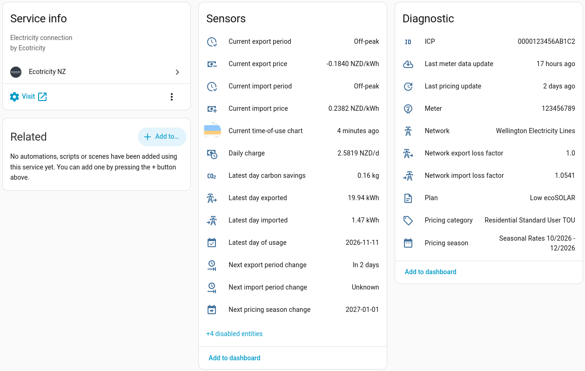
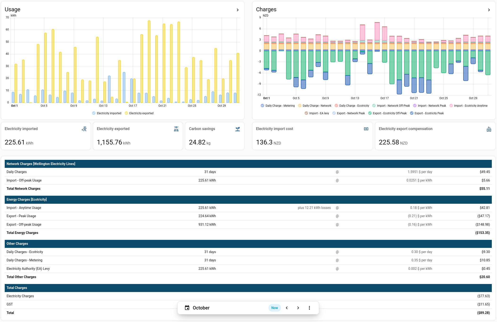
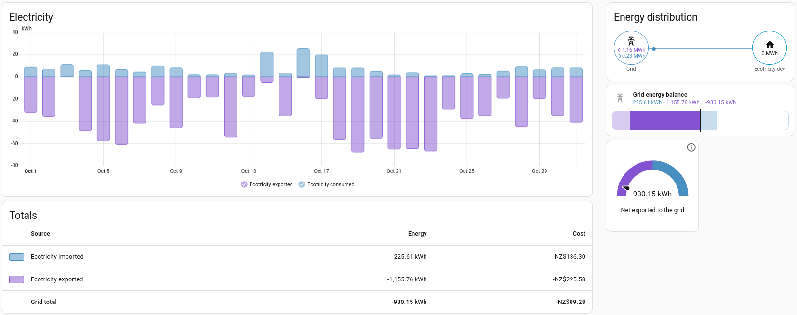

# Ecotricity NZ for Home Assistant

A custom integration for [Ecotricity NZ](https://ecotricity.co.nz) customers. Bring your plan's prices, time-of-use periods, consumption, and billing data into Home Assistant.

This is a community integration and isn't affiliated with Ecotricity NZ. The Ecotricity name and logo belong to Ecotricity NZ and are used only to identify the service.




## Features

- **Current price sensors**: the current import and export prices your paying. Each price is broken down into supplier, network and levy rates via sensor attributes for fine grain reporting.
- **Time-of-use period sensors**: the current TOU period, today's windows, and when the period or price next changes. Connect them with your automations and utility meter helpers to help ensure you're ultising electricity as efficently as possible.
- **Pricing season sensors**: the current Ecotricity and network pricing season, and when the next season starts. Prices can change through-out the year, especially between Summer and Winter.
- **Current time-of-use chart image**: Embeed Ecotricity's current pricing chart in to your dashboards, as an image.
- **Usage history**: hourly import, export and carbon savings statistics, exactly as reported in the Ecotricity portal. This functionality requires your customer portal login.
- **Cost history**: hourly statistics of what your usage cost, in dollars, matching your Ecotricity bill. This functionality also requires your customer portal login.
- **Dashboard bill card**: a dashboard card that lays your costs out like your Ecotricity bill, with each rate's kWh, rate and amount, for any date/time period.

## Installation

Home Assistant **2026.10.4** or later is required.

In Home Assistant, go to **Settings > Marketplace** and search for **Ecotricity NZ**. If using 2026.10 or earlier, which has no Marketplace, install it from [HACS](https://www.hacs.xyz/) the same way.

## Setup

| Field                              | Required | Notes                                                                                                                                                                                                                                 |
| ---------------------------------- | -------- | ------------------------------------------------------------------------------------------------------------------------------------------------------------------------------------------------------------------------------------- |
| ICP number                         | Yes      | The 15-character number on the Electricity Usage Details page of your bill, for example `ICP 0000123456AB1C2`. You can also [look it up on the Electricity Authority website](https://www.ea.govt.nz/your-power/your-meter/address/). |
| Ecotricity customer account number | No       | The account number you log in to the [Ecotricity portal](https://portal.ecotricity.co.nz) with. See [docs/security.md](docs/security.md) for more on how your login information is kept safe.                                         |
| Ecotricity password                | No       | The account password you log in to the [Ecotricity portal](https://portal.ecotricity.co.nz) with. See [docs/security.md](docs/security.md) for more on how your login information is kept safe.                                       |

Configuring your ICP number gets you the pricing and TOU sensors. Also configuring your portal login gets you the additional usage and billing sensors and statistics.

Next, choose the Ecotricity plan for your ICP. Ecotricity's data doesn't reliably say which plan you're currently on, so you need to pick it yourself.

Once the integration is setup, these can be changed under <kbd>Options</kbd> (the cog on the integration):

- **Include GST in import prices**: Adds GST to import prices and daily charges, on by default.
- **Include GST in export prices**: Adds GST to export prices, on by default. Ecotricity's bills charge GST on export credits, even for non-GST registered residental customers.
- **Plan**: the Ecotricity plan your ICP is on. Change it here if you switch plans.

To change or remove your portal login later, use <kbd>Reconfigure</kbd> on the integration. If the Ecotricity portal starts rejecting the configured login, Home Assistant will ask you to sign in again via a repair task.

## Sensor Entities

All entities belong to a device named "**ICP &lt;icp&gt;**", so entity IDs look like `sensor.icp_0000123456ab1c2_current_import_price`. Prices are in NZD/kWh and are broken down in their attributes into `supplier_rate`, `network_rate` and any levies such as `ea_levy`. Only the parts relevent to your current plan are shown. Every price keeps its original sign: a cost is positive and a credit is negative.

### Pricing

| Entity                                      | Description                                                                                                                                                                                | Attributes                                           |
| ------------------------------------------- | ------------------------------------------------------------------------------------------------------------------------------------------------------------------------------------------ | ---------------------------------------------------- |
| Current import price                        | Import price for the current half-hour period.                                                                                                                                             | `period`, `supplier_rate`, `network_rate`, `ea_levy` |
| Current export price                        | Export price for the current half-hour period. Only created if your ICP has an export register.                                                                                            | `period`, `supplier_rate`, `network_rate`            |
| Current controlled price                    | Controlled-load price. Only created if your plan supports controlled loads.                                                                                                                | `supplier_rate`, `network_rate`, `ea_levy`           |
| Daily charge                                | Total fixed charge per day, in NZD/d, excluding any capacity charge (see [Known limitations](#known-limitations)).                                                                         | `supplier_rate`, `network_rate`, `metering_rate`     |
| _Period_ import, export or controlled price | One sensor per period on your plan, for example **Peak import price**, **Off-peak export price**. Disabled by default. Export sensors are only created if your ICP has an export register. | `supplier_rate`, `network_rate`, `ea_levy`           |

A period's price sensor shows that period's price for today, and has no value on days the period doesn't apply (e.g. a winter-only peak period won't show a value in summer). Where Ecotricity's and your network's pricing periods don't exactly line up, the **Current price** sensors still always show the exact price you pay for the current half-hour period.

Anytime, peak and off-peak price sensors have the same names on every plan. Every other price takes its name from your plan's own rate descriptions, exactly as the Ecotricity portal lists. For example, the "Shoulder Usage" rate provides a **Shoulder import price** sensor and the period `shoulder`; the "Super Off Peak Usage" rate provides **Super off peak import price** and `super_off_peak`. Price sensors are only created for prices your plan has in any of its published seasons, including one that have already ended, and are removed if your plan stops having them (e.g. you switch plans). Likewise, the period sensors only list the periods your plan uses as options, so for example, a peak and off-peak only plan won't offer shoulder.

### Time-of-use (TOU)

| Entity                         | Description                                                                                                                    | Attributes                                                    |
| ------------------------------ | ------------------------------------------------------------------------------------------------------------------------------ | ------------------------------------------------------------- |
| Current import period          | `anytime`, `peak`, `off_peak`, or a period named from your plan, such as `shoulder`, `super_off_peak`, `weekend`, etc.         | `windows`, list of today's windows such as `07:00-11:00 peak` |
| Current export period          | As above, for export. Import and export can have different windows. Only created if your ICP has an export register.           | `windows`                                                     |
| Current supplier import period | Ecotricity's own import period. Only created when Ecotricity's and your network's periods don't exactly line up (see below).   | `windows`                                                     |
| Current network import period  | Your network's own import period. Only created when Ecotricity's and your network's periods don't exactly line up (see below). | `windows`                                                     |
| Current supplier export period | As above, for export. Only created if your ICP has an export register.                                                         | `windows`                                                     |
| Current network export period  | As above, for export. Only created if your ICP has an export register.                                                         | `windows`                                                     |
| Next import period change      | When the import period or price next changes.                                                                                  | `period`, `price`                                             |
| Next export period change      | When the export period or price next changes. Only created if your ICP has an export register.                                 | `period`, `price`                                             |
| Next pricing season change     | When the next pricing season starts.                                                                                           |                                                               |
| Current time-of-use chart      | Image of Ecotricity's TOU chart for today.                                                                                     |                                                               |

Each half-hour's price is one of Ecotricity's rates plus one of your network's rates. On most plans both Ecotricity and your network's pricing periods line up perfectly, and there's just one import period and one export period. However, on some network they don't; for example, Ecotricity's evening peak could end at 9pm but the Vector network's winter peak runs to 10pm, so 9pm to 10pm costs Ecotricity's off-peak rate plus the network's peak rate. For those plans, **Current supplier import period** and **Current network import period** (or the export ones) show each side's own period, and **Current import period** shows the overall period, the one whose own price is nearest what you're currently paying. Today's windows split wherever the price changes, so `21:00-22:00 peak` shows up as its own window with its own price. This is slightly complicated in networks where Ecotricity and your network are not fully aligned, but it is nessecary to ensure that pricing is accurately captured in these rare scenarios. If your network periods align with Ecotricity, you can safely ignore all this.

### Usage

These sensors are only enabled if you have configured your Ecotricity customer account details with the integration.

| Entity                    | Description                                                                                                                                                                                                                                  | Attributes             |
| ------------------------- | -------------------------------------------------------------------------------------------------------------------------------------------------------------------------------------------------------------------------------------------- | ---------------------- |
| Latest day of usage       | The latest complete day that contains meter consumption data in the Ecotricity portal. This generally lags a few days behind todays date, but varies depending on how quickly and frequently Ecotricity receives data from your smart meter. |                        |
| Latest day imported       | kWh imported on the latest day of data.                                                                                                                                                                                                      | `date`, `statistic_id` |
| Latest day exported       | kWh exported on the latest day of data.                                                                                                                                                                                                      | `date`, `statistic_id` |
| Latest day carbon savings | kg of carbon saved on the latest day of data.                                                                                                                                                                                                | `date`, `statistic_id` |

### Diagnostic

These describe your electricity connection and integration settings. They're listed under **Diagnostic** on the device page as they infrequently (or never) change.

| Entity                         | Description                                                                                                                                                                                                                                                                | Attributes                                                                                                                                                  |
| ------------------------------ | -------------------------------------------------------------------------------------------------------------------------------------------------------------------------------------------------------------------------------------------------------------------------- | ----------------------------------------------------------------------------------------------------------------------------------------------------------- |
| ICP                            | Your ICP number.                                                                                                                                                                                                                                                           |                                                                                                                                                             |
| Network                        | Your network lines company name.                                                                                                                                                                                                                                           | `code`                                                                                                                                                      |
| Network import loss factor     | Your connection's line loss factor for import. A number above 1.0 means that lines losses applies to your ICP, which will be reflected on your bill.                                                                                                                       |                                                                                                                                                             |
| Network export loss factor     | Your connection's line loss factor for export. A number above 1.0 means line losses applies to your ICP, which will be reflected on your bill. Only created if your ICP has an export register.                                                                            |                                                                                                                                                             |
| Pricing category               | Your network pricing category, such as "Residential Time of Use".                                                                                                                                                                                                          | `code`                                                                                                                                                      |
| Meter                          | Your meter serial number.                                                                                                                                                                                                                                                  | `type`, `smart`, `certification_expiry`                                                                                                                     |
| Plan                           | Your current Ecotricity plan.                                                                                                                                                                                                                                              | `internal_name`, `internal_code`, `expected_network_price_category`, `actual_network_price_category`, `network_price_category_change_required`, `tou_error` |
| Pricing season                 | The current pricing season and its dates.                                                                                                                                                                                                                                  | `start`, `end`, `published`                                                                                                                                 |
| Registered generation capacity | The solar or other generation your network has approved, in kW. Only created when the network has recorded a capacity; some networks record zero even for connections with generation (e.g. solar), so this is not a reliable source of truth (depending on your network). |                                                                                                                                                             |
| Last meter data update         | When Ecotricity's portal last received new readings from your meter.                                                                                                                                                                                                       |                                                                                                                                                             |
| Last pricing update            | When this integration last fetched pricing from Ecotricity's website.                                                                                                                                                                                                      |                                                                                                                                                             |

## Statistic Entities

Consumption history is imported as hourly long-term statistics, going back as far as the Ecotricity portal has data for. The first import runs in the background and can take a few minutes. Statistic IDs use your ICP **in lower case**.

### Usage statistics

| Statistic ID                                    | Name                                  | Unit | What it is           |
| ----------------------------------------------- | ------------------------------------- | ---- | -------------------- |
| `ecotricity_nz:0000123456ab1c2_energy_imported` | Ecotricity &lt;ICP&gt; imported       | kWh  | Total imported units |
| `ecotricity_nz:0000123456ab1c2_energy_exported` | Ecotricity &lt;ICP&gt; exported       | kWh  | Total exported units |
| `ecotricity_nz:0000123456ab1c2_carbon_savings`  | Ecotricity &lt;ICP&gt; carbon savings | kg   | Total carbon savings |

Each ID is also shown in the `statistic_id` attribute of the matching **Latest day** sensor.

Each hour adds up two of the portal's half-hourly readings. The minimum time period supported by Home Assistant is one hour, so half-hourly readings must be merged to the nearest full hour. If a reading is missing, the hours from that point on wait for it for up to a week, then are imported with whatever the portal has.

### Cost statistics

Each half-hour of usage is also priced with the rates that applied to it, and the costs are added up into hourly statistics, one for each part of your bill. Cost parts your plan doesn't have aren't created, and the levy and daily charge items are named after your plan's own, so may differ slightly from these. Each of your plan's rates gets a pair of bill line statistics, like the lines on your bill: what it charged, and the kWh it was charged on. `<code>` is Ecotricity's code for the rate's period, such as `charge_high` or `charge_24` (shown with spaces in the name), so `ecotricity_nz:0000123456ab1c2_line_import_network_charge_high` is the network's peak rate:

| Statistic ID                                                   | Name                                                       | Unit | What it is                                                                                                                                                                                                                                                                  |
| -------------------------------------------------------------- | ---------------------------------------------------------- | ---- | --------------------------------------------------------------------------------------------------------------------------------------------------------------------------------------------------------------------------------------------------------------------------- |
| `ecotricity_nz:0000123456ab1c2_daily_charge_metering`          | Ecotricity &lt;ICP&gt; daily charge (metering)             | NZD  | The daily metering charge. Each daily charge is spread evenly over the hours of its day (23 or 25 hours on the days daylight saving starts and ends).                                                                                                                       |
| `ecotricity_nz:0000123456ab1c2_daily_charge_network`           | Ecotricity &lt;ICP&gt; daily charge (network)              | NZD  | The network's daily charge, spread over the day as above.                                                                                                                                                                                                                   |
| `ecotricity_nz:0000123456ab1c2_daily_charge_supplier`          | Ecotricity &lt;ICP&gt; daily charge (supplier)             | NZD  | Ecotricity's daily charge, spread over the day as above.                                                                                                                                                                                                                    |
| `ecotricity_nz:0000123456ab1c2_line_import_ea_levy`            | Ecotricity &lt;ICP&gt; line (import ea levy)               | NZD  | The Electricity Authority levy, on all of your usage.                                                                                                                                                                                                                       |
| `ecotricity_nz:0000123456ab1c2_line_import_network_<code>`     | Ecotricity &lt;ICP&gt; line (import network &lt;code&gt;)  | NZD  | The network's rate for the `<code>` period, on your usage in that period.                                                                                                                                                                                                   |
| `ecotricity_nz:0000123456ab1c2_line_import_supplier_<code>`    | Ecotricity &lt;ICP&gt; line (import supplier &lt;code&gt;) | NZD  | Ecotricity's energy rate for the `<code>` period, on your usage in that period plus line losses (the **Network import loss factor**), as your bill charges it.                                                                                                              |
| `ecotricity_nz:0000123456ab1c2_line_export_network_<code>`     | Ecotricity &lt;ICP&gt; line (export network &lt;code&gt;)  | NZD  | The network's export rate for the `<code>` period, if it has one: negative for a credit, positive for a charge.                                                                                                                                                             |
| `ecotricity_nz:0000123456ab1c2_line_export_supplier_<code>`    | Ecotricity &lt;ICP&gt; line (export supplier &lt;code&gt;) | NZD  | Ecotricity's export rate for the `<code>` period, on what you exported in that period plus line losses (the **Network export loss factor**), the same way as import. A credit, so it's negative. The export statistics are only created if your ICP has an export register. |
| `ecotricity_nz:0000123456ab1c2_total_electricity_cost`         | Ecotricity &lt;ICP&gt; total electricity cost              | NZD  | Everything you're charged for using electricity: your usage, the levies, the daily charges and GST. For use the Energy dashboard.                                                                                                                                           |
| `ecotricity_nz:0000123456ab1c2_total_electricity_compensation` | Ecotricity &lt;ICP&gt; total electricity compensation      | NZD  | Every export amount and its GST, with the sign flipped so a credit is positive, as the Energy dashboard expects. Only created if your ICP has an export register.                                                                                                           |

The daily charges, the levies and the bill lines are excluding GST, whatever the **Include GST** options are configured as in the integration, and together they add up to your bills "before GST" subtotal, export credits included. Your bill then charges GST on that total. Only the two "total electricity cost" and "total electricity compensation" statistics for the Energy dashboard include GST. Anything else you might want, such as everything the network charged, the GST or the bill's total, is a sum of these, so it isn't stored again; the bill card works it out for you. Like the price sensors, export keeps its sign, so a credit is negative and is drawn below zero in a chart, and a network that charges you for exporting shows a positive cost.

Costs are worked out from the pricing the integration has saved, so they only go back as far as that pricing does: the start of the current pricing year (usually 1 April, but sometimes earlier). To price the earlier seasons of the year, the integration downloads their time-of-use charts once each. Usage from before then isn't given costs. Costs wait for a day whose prices can't be worked out yet (e.g. its chart data can't be read) the same way usage waits for a missing reading.

## Actions

| Action                  | Description                                                                                                                                    | Fields                                                                                             |
| ----------------------- | ---------------------------------------------------------------------------------------------------------------------------------------------- | -------------------------------------------------------------------------------------------------- |
| `ecotricity_nz.refresh` | Fetches the latest pricing and usage now, instead of waiting for the next scheduled update. Usage only goes as far as the portal has data for. | `config_entry_id` (optional): the ICP to refresh. Can be left out if you only have one configured. |

## Updates and working offline

Pricing data comes from Ecotricity's public website, which requires internet access. The integration saves this data locally when fetched, and works out each day's prices and periods from the saved copy, so they keep working through restarts and internet outages. Once Ecotricity publishes the next price season, the next fetch saves its pricing and time-of-use charts too, so the new season starts on time even if you're offline at midnight. The integration checks once a day whether anything needs fetching. It fetches weekly, on the 1st of each month, on the last day of each season, and daily while no published season covers today or tomorrow (from a season's last day until Ecotricity publishes the next) or today's time-of-use chart can't be read. If a chart is missing, or shows prices that don't match your plan's rates, on an import or export side where Ecotricity and your network each have only one rate, such as on an anytime plan, it's fetched again daily up to three times, then only at the usual times. A chart that goes missing later gets its own three tries, even if another is still missing. Restarting Home Assistant doesn't start the count again. The **Last pricing update** sensor shows when it last fetched.

Usage data is imported from the Ecotricity customer portal once a day. If an import finds nothing new, the integration checks the portal again every 3 hours until the day's data appears.

## Using it with the Energy dashboard

1. Go to **Settings > Dashboards > Energy**.
1. Under **Grid consumption**, configure
   - **Ecotricity &lt;ICP&gt; imported** as your energy import sensor.
   - **Ecotricity &lt;ICP&gt; exported** as your energy export sensor. (if you export)
1. To see costs, choose **Use an entity tracking the total costs** for the import, and pick **Ecotricity &lt;ICP&gt; total electricity cost**. It includes the daily charges, usage charges, and GST, same as your actual Ecotricity bill.
1. If you export, choose **Use an entity tracking the total received money** for the export, and pick **Ecotricity &lt;ICP&gt; total electricity compensation**. Unlike the other cost statistics, this is positive for a credit, as the Energy dashboard counts money received as positive and takes it off your costs. It include GST, same as your actual Ecotricity bill.

Usage data may lag behind by a day or two, depending on when Ecotricity receives and processes your meter data.



## Using it in custom dashboards

You can emulate the Ecotricity portal consumption chart and bill visualisation using the energy date selector, statistics graph card, and the **Ecotricity bill** card that is supplied by this integration:


The entity names for statistics attached to your ICP may slightly differ depending on your Ecotricity plan and network, use these as a base templates only, you'll need to replace all entity IDs with your own.

### Electricity usage chart

```yaml
type: grid
cards:
  - type: energy-date-selection
    collection_key: energy_ecotricity
    grid_options:
      columns: full
  - type: statistics-graph
    collection_key: energy_ecotricity
    entities:
      - entity: ecotricity_nz:0000123456ab1c2_energy_imported
        name: Electricity imported
        color: "#7cb5ec"
      - entity: ecotricity_nz:0000123456ab1c2_energy_exported
        name: Electricity exported
        color: "#f2d21b"
    title: Usage
    period: auto
    chart_type: bar
    stat_types:
      - change
    hide_legend: false
    logarithmic_scale: false
    energy_date_selection: true
    grid_options:
      columns: full
  - type: statistic
    collection_key: energy_ecotricity
    name: Electricity imported
    entity: ecotricity_nz:0000123456ab1c2_energy_imported
    icon: mdi:transmission-tower-import
    stat_type: change
    energy_date_selection: true
    period:
      calendar:
        period: day
  - type: statistic
    collection_key: energy_ecotricity
    name: Electricity exported
    entity: ecotricity_nz:0000123456ab1c2_energy_exported
    icon: mdi:solar-power-variant
    stat_type: change
    energy_date_selection: true
    period:
      calendar:
        period: day
  - type: statistic
    collection_key: energy_ecotricity
    name: Carbon savings
    entity: ecotricity_nz:0000123456ab1c2_carbon_savings
    icon: mdi:sprout
    stat_type: change
    energy_date_selection: true
    period:
      calendar:
        period: day
```

### Electricity bill chart

```yaml
type: grid
cards:
  - type: energy-date-selection
    collection_key: energy_ecotricity
    grid_options:
      columns: full
  - type: statistics-graph
    collection_key: energy_ecotricity
    entities:
      - entity: ecotricity_nz:0000123456ab1c2_daily_charge_metering
        name: Daily Charge - Metering
      - entity: ecotricity_nz:0000123456ab1c2_daily_charge_network
        name: Daily Charge - Network
      - entity: ecotricity_nz:0000123456ab1c2_daily_charge_supplier
        name: Daily Charge - Ecotricity
      - entity: ecotricity_nz:0000123456ab1c2_line_import_network_charge_low
        name: Import - Network Off-Peak
      - entity: ecotricity_nz:0000123456ab1c2_line_import_network_charge_high
        name: Import - Network Peak
      - entity: ecotricity_nz:0000123456ab1c2_line_import_supplier_charge_24
        name: Import - Ecotricity Anytime
      - entity: ecotricity_nz:0000123456ab1c2_line_import_ea_levy
        name: Import - EA levy
      - entity: ecotricity_nz:0000123456ab1c2_line_export_network_charge_low
        name: Export - Network Off-Peak
      - entity: ecotricity_nz:0000123456ab1c2_line_export_network_charge_high
        name: Export - Network Peak
      - entity: ecotricity_nz:0000123456ab1c2_line_export_supplier_charge_low
        name: Export - Ecotricity Off-Peak
      - entity: ecotricity_nz:0000123456ab1c2_line_export_supplier_charge_high
        name: Export - Ecotricity Peak
      - entity: ecotricity_nz:0000123456ab1c2_gst
        name: GST
    title: Charges
    period: auto
    chart_type: bar-stack
    stat_types:
      - change
    hide_legend: false
    logarithmic_scale: false
    energy_date_selection: true
  - type: statistic
    collection_key: energy_ecotricity
    name: Electricity import cost
    entity: ecotricity_nz:0000123456ab1c2_total_electricity_cost
    icon: mdi:cash
    stat_type: change
    energy_date_selection: true
    period:
      calendar:
        period: day
  - type: statistic
    collection_key: energy_ecotricity
    name: Electricity export compensation
    entity: ecotricity_nz:0000123456ab1c2_total_electricity_compensation
    icon: mdi:cash-refund
    stat_type: change
    energy_date_selection: true
    period:
      calendar:
        period: day
```

### Bill card

The integration adds an **Ecotricity bill** card to your dashboards. It shows your costs laid out like the **Electricity Usage Details** page of your bill. Pair it with an **Energy date picker** card that has the same `collection_key`, and the bill follows whatever day, week, month or custom range you pick:

```yaml
type: grid
cards:
  - type: energy-date-selection
    collection_key: energy_ecotricity
  - type: custom:ecotricity-bill-card
    collection_key: energy_ecotricity
```

| Option                     | Description                                                                                                                                                                                        |
| -------------------------- | -------------------------------------------------------------------------------------------------------------------------------------------------------------------------------------------------- |
| `title`                    | Optional card title.                                                                                                                                                                               |
| `icp`                      | Which ICP to show, when you've set up more than one.                                                                                                                                               |
| `config_entry_id`          | An alternative to `icp`: the ID of the integration entry to show, from the URL of its page.                                                                                                        |
| `collection_key`           | The energy date picker to follow. It must start with `energy_`. Without it, the card shows the current billing period so far (see `billing_period_start_day`).                                     |
| `billing_period_start_day` | Without a date picker, the day of the month your bills start on, from 1 to 28. Defaults to 1, the calendar month.                                                                                  |
| `compact`                  | `true` leaves out the losses and unit price columns, and the network's and Ecotricity's names in the section headings, for a narrow card. The columns are always left out on a phone-width screen. |
| `show_empty_lines`         | `true` also lists your plan's lines that charged nothing in the range, such as a season's rate out of season.                                                                                      |
| `header_color`             | The section heading bars' colour, as any CSS colour, such as `"#2e7d32"`. A theme can set it for every card with `ecotricity-bill-header-color`.                                                   |

Daily charges count only the days whose usage has been imported, since that's when they're charged: a month that's only been imported to the 23rd shows 23 days, at the same daily rate as the **Daily charge** sensor.

Rates are averages over the range, so they can differ a little from your bill's when a rate changed partway through it. Lines your plan has but that charged nothing in the range are left out. Like your bill, every line excludes GST, whatever the integration's **Include GST** options (which are for the sensors): the card adds up the total charges excluding GST, with export credits taken off, then shows the GST on that total and the total including it. When your credits outweigh your charges, the GST is a credit too, as on your bill. Credits are shown in brackets.

## Using it in automations

Start the dishwasher when the import off-peak window starts:

```yaml
automation:
  - alias: Switch dishwasher on when import price is off-peak
    triggers:
      - trigger: state
        entity_id: sensor.icp_0000123456ab1c2_current_import_period
        to: off_peak
    actions:
      - action: switch.turn_on
        target:
          entity_id: switch.dishwasher
```

Switch a solar inverter to prioritise exporting when export is paid at the peak rate, then back to prioritising battery storage when off-peak starts:

```yaml
automation:
  - alias: Prioritise solar exporting over battery when export price is peak
    triggers:
      - trigger: state
        entity_id: sensor.icp_0000123456ab1c2_current_export_period
        to: peak
        id: peak
      - trigger: state
        entity_id: sensor.icp_0000123456ab1c2_current_export_period
        to: off_peak
        id: off_peak
    actions:
      - action: select.select_option
        target:
          entity_id: select.inverter_work_mode
        data:
          option: "{{ 'Export first' if trigger.id == 'peak' else 'Battery first' }}"
```

## Known limitations

- Only residential plans are supported.
- Ecotricity publishes peak and off-peak hours only as chart images, not as data. The integration reads the price list under each chart and checks every price against the plan's rates. If a price can't be read, or the rates don't explain it, the chart is treated as unreadable rather than guessed. When a chart can't be read, the current price and period sensors become unavailable, the **Plan** sensor's `tou_error` attribute says why, and a repair notice appears if it still can't be read after three fetches in a row. Export charts are only checked if your ICP has an export register. Each period's price sensor then shows the price from the plan's rates where the rates alone settle it, and no period's sensor is removed until the charts can be read again. The same goes for a later season's charts: until they can be read, no sensor is removed, since that season may have periods today's doesn't. Import and export are checked separately, so if only the export prices are unreadable, the import sensors keep working. If a chart can't be downloaded, or shows prices that don't match the rates, on an import or export side where Ecotricity and your network each have only one rate, such as an anytime plan, the network's rate is taken to apply all day and the chart is tried again daily up to three times, then only at the usual times (weekly, the 1st of the month and a season's last day). This only happens when the chart shows one price all day, or none of the plan's prices.
- Ecotricity bills its energy rates on your usage plus line losses, but its charts, and so the price sensors, leave the losses out.
- Cost statistics assume the plan chosen in the options applied throughout. If you change plan, costs already worked out stay as they were, and only later hours use the new plan. They also leave out controlled-load usage, as the portal doesn't report it separately (still to be confirmed with a real controlled-load ICP), and capacity charges (see below). If Ecotricity renames a levy or daily charge item, its costs carry on in a new statistic named after it.
- Usage from the last day or two of a pricing year (usually 31 March) arrives after the new year's pricing is fetched. If Ecotricity stops listing last year's rates by then, those hours get no costs.
- The **Daily charge** leaves out capacity charges, which some networks (such as Scanpower) charge per kVA of your connection's capacity instead of a daily network charge. Ecotricity doesn't publish your connection's kVA, so the integration can't work them out. If this issue impacts you, please log a ticket or open a discussion to help us better understand the requirements for this functionality.
- The bill card's lines are your current plan's rates. Costs from a plan you've since left are still in the totals, but have no line of their own.
- Controlled-load support hasn't been tested against a real controlled-load ICP. It's based on Ecotricity's site code and the electricity registry's codes. If your controlled-load prices look wrong, please open an issue.
- Ecotricity's onboarding website guards its data with a browser check, which this integration reproduces in code. If Ecotricity changes that check, pricing updates stop until the integration is updated, and a repair notice tells you so. The saved pricing keeps working, so the current season's prices and windows carry on, and so does the next season if Ecotricity had already published it. A season published after that won't be picked up.

## Troubleshooting

- **No usage data**: make sure you can log in at https://portal.ecotricity.co.nz, then check the **Last meter data update** sensor. New accounts may have no data for a few days.
- **Wrong prices**: check the **Plan** sensor shows the plan you're on, and change it in the options if not. If Ecotricity stops listing your plan for your ICP, a repair notice asks you to choose again.
- **Network charges don't match the plan's advertised prices**: Ecotricity lists low-user plans with the network's low-user rates and standard plans with its standard rates, and expects to have the network move your ICP to the plan's category when you join. Until the network does, it charges your ICP's registered category (the **Pricing category** sensor), so the integration prices your plan with that category's network rates and a repair notice says so. The **Plan** sensor's `expected_network_price_category` and `actual_network_price_category` attributes show the two side by side, and `network_price_category_change_required` is true while they differ. If you expected the plan's advertised network charges, ask Ecotricity to have your ICP moved to the correct network price category; the notice goes once the registry shows the move is complete.
- **Bill card missing or stuck on loading**: refresh the browser page after updating the integration. If it says there's no energy date picker, add an `energy-date-selection` card to the same dashboard with the same `collection_key`. Its lines start appearing after the next usage import.
- For anything else, turn on debug logging for the integration, reproduce the problem, and open an issue with the log and the downloaded diagnostics (they hide your ICP, login and address to protect you PII).

## Removing it

Go to **Settings > Devices & services**, open **Ecotricity NZ**, and delete the entry. Imported statistics stay in your history until you remove them under **Developer tools > Statistics**.

## Security and privacy

See [docs/security.md](docs/security.md) for how your portal login is stored and used, and what data is sent outside Home Assistant.

## Development

See [docs/development.md](docs/development.md) for building and testing locally, [docs/architecture.md](docs/architecture.md) for how it works, and [docs/api.md](docs/api.md) for what's known about Ecotricity's services.

## Licence

[MIT](LICENSE)
