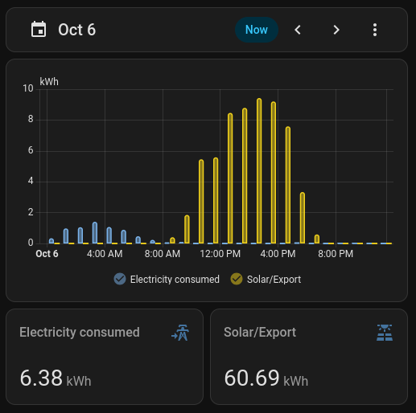

# Ecotricity NZ for Home Assistant

A custom integration for [Ecotricity NZ](https://ecotricity.co.nz) customers. It brings your plan's prices, time-of-use periods and half-hourly usage into Home Assistant.

This is a community integration and isn't affiliated with Ecotricity NZ. The Ecotricity name and logo belong to Ecotricity NZ and are used only to identify the service.


## Features

- **Current prices**: the exact import and export price right now. Each price is broken down into supplier, network and levy rates via sensor attributes.
- **Time-of-use periods**: the current period, today's windows, and when the period or price next changes. Useful for automations and utility meter helpers. Where Ecotricity's and your network's TOU periods don't line up, they each get a sensor so you can track usage accurately.
- **Every price on your plan**: a sensor for each period's price, plus the fixed daily charge. The fixed daily charge is broken down into supplier, network, and metering hire rates via sensor attributes.
- **Pricing seasons**: the current season and when the next one starts, as prices and windows can change between them.
- **Current time-of-use chart**: Ecotricity's own chart for today, as an image.
- **Usage history**: hourly import, export and carbon savings statistics, backfilled as far back as the Ecotricity portal data goes. This functionality requires your customer portal login.
- **Cost history**: hourly statistics of what your usage cost, in dollars, split into each part of your bill: Ecotricity's and the network's rates, levies, daily charges, GST and export credits. Stack them in a chart to recreate your bill for any period. Also requires your portal login.
- **Bill card**: a dashboard card that lays your costs out like your Ecotricity bill, with each rate's kWh, rate and amount, for whatever dates the dashboard's date picker shows. Comes with the integration; nothing else to install.
- **Controlled load**: prices for controlled-load supply such as ripple-controlled hot water, if your plan has them.
- **ICP, smart meter, and regional network info**: sensors for your ICP number, smart meter serial number (with type and certification expiry attributes), regional network, and your connection's import and export line loss factors.

## Installation

Home Assistant **2026.10** or later is required.

### Automatic via HACS (recommended)

[](https://my.home-assistant.io/redirect/hacs_repository/?owner=rhyskoedijk&repository=ha-ecotricity-nz&category=Integration)

Click **Download** in HACS, then restart Home Assistant.

### Manual via HACS

1. In HACS, open the menu, choose **Custom repositories**, and add `https://github.com/rhyskoedijk/ha-ecotricity-nz` as an **Integration**.
2. Search HACS for **Ecotricity NZ** and download it.
3. Restart Home Assistant.
4. Go to **Settings > Devices & services > Add integration** and choose **Ecotricity NZ**.

## Setup

| Field                              | Required | Notes                                                                                                                                                                                       |
| ---------------------------------- | -------- | ------------------------------------------------------------------------------------------------------------------------------------------------------------------------------------------- |
| ICP number                         | Yes      | The 15-character number on your bill, for example `0000123456AB1C2`. You can also [look it up on the Electricity Authority website](https://www.ea.govt.nz/your-power/your-meter/address/). |
| Ecotricity customer account number | No       | The account number you log in to the [Ecotricity portal](https://portal.ecotricity.co.nz) with.                                                                                             |
| Ecotricity password                | No       | Your [Ecotricity portal](https://portal.ecotricity.co.nz) password. See [docs/security.md](docs/security.md) for how your login is kept safe.                                               |

With only the ICP number you get the pricing sensors. Add your portal login to get the usage sensors and statistics too.

Next, choose your plan from the plans Ecotricity offers for your ICP. Ecotricity's data doesn't reliably say which plan you're on, so you always pick it yourself.

Once it's set up, these can be changed under <kbd>Options</kbd> (the cog on the integration):

- **Include GST in prices**: on by default. Adds GST to import prices and daily charges; export prices never include it.
- **Plan**: the Ecotricity plan your ICP is on. Change it here if you switch plans.

To change or remove your portal login later, use <kbd>Reconfigure</kbd> on the integration. If the portal starts rejecting the saved login, Home Assistant asks you to sign in again.

## Sensor Entities

All entities belong to a device named **ICP &lt;icp&gt;**, so entity IDs look like `sensor.icp_0000123456ab1c2_current_import_price`. Prices are in NZD/kWh and are broken down in their attributes into `supplier_rate`, `network_rate` and any levies such as `ea_levy`. Only the parts your plan has are shown. Every price keeps its sign: a cost is positive and a credit is negative, so an export price you're paid for shows as a negative value.

### Pricing

| Entity                                      | Description                                                                                 | Attributes                                           |
| ------------------------------------------- | ------------------------------------------------------------------------------------------- | ---------------------------------------------------- |
| Current import price                        | Import price for the current half-hour.                                                     | `period`, `supplier_rate`, `network_rate`, `ea_levy` |
| Current export price                        | Export price for the current half-hour. Only created if your ICP has an export register.    | `period`, `supplier_rate`, `network_rate`            |
| Current controlled price                    | Controlled-load price. Only created if your plan has one.                                   | `supplier_rate`, `network_rate`, `ea_levy`           |
| Daily charge                                | Total fixed charge per day, in NZD/d, apart from any capacity charge (see [Known limitations](#known-limitations)). | `supplier_rate`, `network_rate`, `metering_rate`     |
| _Period_ import, export or controlled price | One sensor per period on your plan, for example **Peak import price**. Disabled by default. Export ones are only created if your ICP has an export register. | `supplier_rate`, `network_rate`, `ea_levy`           |

A period's price sensor shows that period's own price today, and has no value on days the period doesn't apply (a winter-only peak in summer, say). Where Ecotricity's and your network's periods don't line up, the **Current price** sensors still always show the exact price. Anytime, peak and off-peak have the same names on every plan. Every other price takes its name from your plan's own rate descriptions, the same ones the Ecotricity portal lists. For example, the "Shoulder Usage" rate provides a **Shoulder import price** sensor and the period `shoulder`; the "Super Off Peak Usage" rate provides **Super off peak import price** and `super_off_peak`. These names follow your plan, so if Ecotricity renames a rate, the sensor's name changes with it (its entity ID and history stay the same). Price sensors are only created for prices your plan has in any of its published seasons, including one that has ended, and are removed if your plan stops having them (e.g. you switch plans). Likewise, the period sensors only list the periods your plan uses as options, so for example, a peak and off-peak only plan won't offer shoulder.

### Time of use

| Entity                         | Description                                                                                                            | Attributes                                                    |
| ------------------------------ | ---------------------------------------------------------------------------------------------------------------------- | ------------------------------------------------------------- |
| Current import period          | `anytime`, `peak`, `off_peak`, or a period named from your plan, such as `shoulder`, `super_off_peak`, `weekend`, etc. | `windows`, list of today's windows such as `07:00-11:00 peak` |
| Current export period          | As above, for export. Import and export can have different windows. Only created if your ICP has an export register.  | `windows`                                                     |
| Current supplier import period | Ecotricity's own import period. Only created where Ecotricity's and your network's periods don't line up (see below).  | `windows`                                                     |
| Current network import period  | Your network's own import period. Only created alongside the one above.                                                | `windows`                                                     |
| Current supplier export period | As above, for export. Only created if your ICP has an export register.                                                 | `windows`                                                     |
| Current network export period  | As above, for export. Only created if your ICP has an export register.                                                 | `windows`                                                     |
| Next import period change      | When the import period or price next changes.                                                                          | `period`, `price`                                             |
| Next export period change      | When the export period or price next changes. Only created if your ICP has an export register.                         | `period`, `price`                                             |
| Next pricing season change     | When the pricing season next starts.                                                                                   |                                                               |
| Current time-of-use chart      | Image of Ecotricity's chart for today's day type and season.                                                           |                                                               |

Each half-hour's price is one of Ecotricity's rates plus one of your network's rates. On most plans both Ecotricity and your network's pricing periods line up, and there's just one import period and one export period. However, on some network they don't; for example, Ecotricity's evening peak could end at 9pm but the Vector network's winter peak runs to 10pm, so 9pm to 10pm costs Ecotricity's off-peak rate plus the network's peak rate. For those plans, **Current supplier import period** and **Current network import period** (or the export ones) show each side's own period, and **Current import period** shows the overall period, the one whose own price is nearest what you're currently paying. Today's windows split wherever the price changes, so `21:00-22:00 peak` shows up as its own window with its own price. This is slightly complicated in networks where Ecotricity and your network are not fully aligned, but it is important to ensure that pricing is accurately captured in these scenarios. If your network periods align with Ecotricity, you can safely ignore all this.

### Usage

These sensors are only enabled if you have supplied your Ecotricity customer account details during integration configuration.

| Entity                    | Description                                                                                                                                                                                         | Attributes             |
| ------------------------- | --------------------------------------------------------------------------------------------------------------------------------------------------------------------------------------------------- | ---------------------- |
| Latest day of usage       | The latest complete day that contains meter consumption data in the Ecotricity portal. This generally lags a few days behind todays date, due to the delay in receiving data from your smart meter. |                        |
| Latest day imported       | kWh imported on the latest day of data.                                                                                                                                                             | `date`, `statistic_id` |
| Latest day exported       | kWh exported on the latest day of data.                                                                                                                                                             | `date`, `statistic_id` |
| Latest day carbon savings | kg of carbon saved on the latest day of data.                                                                                                                                                       | `date`, `statistic_id` |

### Diagnostic

These describe your electricity connection and integration settings. They're listed under **Diagnostic** on the device page.

| Entity                         | Description                                                                                                                                                                                                                                      | Attributes                              |
| ------------------------------ | ------------------------------------------------------------------------------------------------------------------------------------------------------------------------------------------------------------------------------------------------ | --------------------------------------- |
| ICP                            | Your ICP number.                                                                                                                                                                                                                                 |                                         |
| Network                        | Your network lines company.                                                                                                                                                                                                                      | `code`                                  |
| Network import loss factor     | Your connection's line loss factor for import, such as 1.045.                                                                                                                                                                                    |                                         |
| Network export loss factor     | Your connection's line loss factor for export. Only created if your ICP has an export register.                                                                                                                                                                       |                                         |
| Pricing category               | Your network pricing category, such as "Residential Time of Use".                                                                                                                                                                                | `code`                                  |
| Meter                          | Your meter serial number.                                                                                                                                                                                                                        | `type`, `smart`, `certification_expiry` |
| Plan                           | Your current Ecotricity plan. Its `tou_error` attribute says why the time-of-use hours can't be read, and is empty when they can.                                                                                                                | `internal_name`, `code`, `tou_error`    |
| Pricing season                 | The current pricing season and its dates.                                                                                                                                                                                                        | `start`, `end`, `published`             |
| Registered generation capacity | The solar or other generation your network has approved, in kW. Only created when the network has recorded a capacity, and added without a restart if one is recorded later; some record zero even for connections with generation (e.g. solar). |                                         |
| Last meter data update         | When Ecotricity's portal last received new readings from your meter.                                                                                                                                                                             |                                         |
| Last pricing update            | When this integration last fetched pricing from Ecotricity's website.                                                                                                                                                                            |                                         |

## Statistic Entities

Consumption history is imported as hourly long-term statistics, going back as far as the Ecotricity portal has data for. The first import runs in the background and can take a few minutes. Statistic IDs use your ICP **in lower case**.

| Statistic ID                          | Name                                  | Unit |
| ------------------------------------- | ------------------------------------- | ---- |
| `ecotricity_nz:<icp>_energy_imported` | Ecotricity &lt;ICP&gt; imported       | kWh  |
| `ecotricity_nz:<icp>_energy_exported` | Ecotricity &lt;ICP&gt; exported       | kWh  |
| `ecotricity_nz:<icp>_carbon_savings`  | Ecotricity &lt;ICP&gt; carbon savings | kg   |

Each ID is also shown in the `statistic_id` attribute of the matching **Latest day** sensor, ready to copy, and under **Developer tools > Statistics**.

Each hour adds up two of the portal's half-hourly readings. The minimum time period supported by Home Assistant is one hour, so half-hourly readings must be merged to the nearest full hour. If a reading is missing, the hours from that point on wait for it for up to a week, then are imported with whatever the portal has.

### Cost statistics

Each half-hour of usage is also priced with the rates that applied to it, and the costs are added up into hourly statistics, one for each part of your bill. All are in NZD. Parts your plan doesn't have aren't created, and the levy and daily charge items are named after your plan's own, so yours may differ from these:

| Statistic ID                                         | Name                                                  | What it is                                                                                                                                      |
| ---------------------------------------------------- | ----------------------------------------------------- | ----------------------------------------------------------------------------------------------------------------------------------------------- |
| `ecotricity_nz:<icp>_daily_charge_metering`          | Ecotricity &lt;ICP&gt; daily charge (metering)        | The daily metering charge. Each daily charge is spread evenly over the hours of its day (23 or 25 on the days daylight saving starts and ends). |
| `ecotricity_nz:<icp>_daily_charge_network`           | Ecotricity &lt;ICP&gt; daily charge (network)         | The network's daily charge.                                                                                                                     |
| `ecotricity_nz:<icp>_daily_charge_supplier`          | Ecotricity &lt;ICP&gt; daily charge (supplier)        | Ecotricity's daily charge.                                                                                                                      |
| `ecotricity_nz:<icp>_daily_charge_total`             | Ecotricity &lt;ICP&gt; daily charge total             | All the daily charges above added up, excluding GST.                                                                                            |
| `ecotricity_nz:<icp>_import_cost_ea_levy`            | Ecotricity &lt;ICP&gt; import cost (ea levy)          | The Electricity Authority levy, on your usage.                                                                                                  |
| `ecotricity_nz:<icp>_import_cost_network`            | Ecotricity &lt;ICP&gt; import cost (network)          | The network's rate, on your usage.                                                                                                              |
| `ecotricity_nz:<icp>_import_cost_supplier`           | Ecotricity &lt;ICP&gt; import cost (supplier)         | Ecotricity's energy rate, on your usage plus line losses (the **Network import loss factor**), as your bill charges it.                         |
| `ecotricity_nz:<icp>_import_cost_total`              | Ecotricity &lt;ICP&gt; import cost total              | All the import costs above added up, excluding GST.                                                                                             |
| `ecotricity_nz:<icp>_export_network`                 | Ecotricity &lt;ICP&gt; export (network)               | The network's export rate. The export statistics are only created if your ICP has an export register.                                           |
| `ecotricity_nz:<icp>_export_supplier`                | Ecotricity &lt;ICP&gt; export (supplier)              | Ecotricity's export rate.                                                                                                                       |
| `ecotricity_nz:<icp>_export_total`                   | Ecotricity &lt;ICP&gt; export total                   | All the export amounts above added up.                                                                                                          |
| `ecotricity_nz:<icp>_gst`                            | Ecotricity &lt;ICP&gt; GST                            | GST on the import costs and daily charges. Export has no GST.                                                                                   |
| `ecotricity_nz:<icp>_total_electricity_compensation` | Ecotricity &lt;ICP&gt; total electricity compensation | The export total with its sign flipped, so a credit is positive, as the Energy dashboard expects. No GST.                                       |
| `ecotricity_nz:<icp>_total_electricity_cost`         | Ecotricity &lt;ICP&gt; total electricity cost         | Everything you're charged for using electricity: the import costs, daily charges and GST. For the Energy dashboard.                             |
| `ecotricity_nz:<icp>_total_electricity_net_billed`   | Ecotricity &lt;ICP&gt; total electricity net billed   | What your bill comes to: the total electricity cost plus the export total, so export credits are taken off.                                     |

Every part is excluding GST, and GST is its own statistic, so adding up every part and GST gives your bill's total, whatever the **Include GST** option says. The totals add up the parts for you; don't stack them with the parts, or they're counted twice. The total electricity net billed is the bill's total. Like the price sensors, export keeps its sign, so a credit is negative and is drawn below zero in a chart, and a network that charges for export shows a positive cost.

Costs are worked out from the pricing the integration has saved, so they only go back as far as that pricing does: the start of the current pricing year (usually 1 April). To price the earlier seasons of the year, the integration downloads their time-of-use charts once each. Usage from before then isn't given costs. Costs wait for a day whose prices can't be worked out yet (its chart can't be read, say) the same way usage waits for a missing reading.

Each of your plan's rates also has a pair of bill line statistics, like the lines on your bill: what that rate charged, in NZD (`ecotricity_nz:<icp>_line_<import|export>_<supplier|network>_<code>`), and the kWh it was charged on (the same ID ending `_energy`). `<code>` is Ecotricity's code for the rate's period, such as `charge_high` or `charge_24`, so `ecotricity_nz:<icp>_line_import_network_charge_high` is the network's peak rate. Together, a side's supplier or network lines add up to its import or export cost above. The bill card reads them; you can chart them too.

## Actions

| Action                  | Description                                                                                                                                    | Fields                                                                                  |
| ----------------------- | ---------------------------------------------------------------------------------------------------------------------------------------------- | --------------------------------------------------------------------------------------- |
| `ecotricity_nz.refresh` | Fetches the latest pricing and usage now, instead of waiting for the next scheduled update. Usage only goes as far as the portal has data for. | `config_entry_id` (optional): the ICP to refresh. Can be left out if you only have one. |

## Updates and working offline

Pricing data comes from Ecotricity's public website, which requires internet access. The integration saves this data locally when fetched, and works out each day's prices and periods from the saved copy, so they keep working through restarts and internet outages. Once Ecotricity publishes the next season, the next fetch saves its pricing and time-of-use charts too, so the new season starts on time even if you're offline at midnight. The integration checks once a day whether anything needs fetching. It fetches weekly, on the 1st of each month, on the last day of each season, and daily while next season's pricing isn't published yet or today's time-of-use chart can't be read. If a chart is missing, or shows prices that don't match your plan's rates, on an import or export side where Ecotricity and your network each have only one rate, such as on an anytime plan, it's fetched again daily up to three times, then only at the usual times. A chart that goes missing later gets its own three tries, even if another is still missing. Restarting Home Assistant doesn't start the count again. The **Last pricing update** sensor shows when it last fetched.

Usage data is imported from the Ecotricity customer portal once a day. If an import finds nothing new, the integration checks the portal again every 3 hours until the day's data appears.

## Using it with the Energy dashboard

1. Go to **Settings > Dashboards > Energy**.
2. Under **Grid consumption**, add **Ecotricity &lt;ICP&gt; imported** as your energy import sensor.
3. If you export, add **Ecotricity &lt;ICP&gt; exported** as your energy export sensor.
4. To see costs, choose **Use an entity tracking the total costs** for the import, and pick **Ecotricity &lt;ICP&gt; total electricity cost**. It includes the daily charges and GST, so the dashboard's cost matches your bill.
5. If you export, choose **Use an entity tracking the total received money** for the export, and pick **Ecotricity &lt;ICP&gt; total electricity compensation**. Unlike the other cost statistics, it's positive for a credit, as the Energy dashboard counts money received as positive and takes it off your costs.

Usage will appears a day or two after it happens, depending on when Ecotricity receives and processes your meter data.


## Using it in charts

You can emulate the Ecotricity portal consumption chart using a energy date selector and statistics graph cards:



```yaml
type: grid
cards:
  - type: energy-date-selection
    collection_key: energy_ecotricity
    disable_compare: true
    grid_options:
      columns: full
  - type: statistics-graph
    chart_type: bar
    stat_types:
      - change
    energy_date_selection: true
    collection_key: energy_ecotricity
    entities:
      - entity: ecotricity_nz:0000123456ab1c2_energy_imported
        name: Electricity consumed
        color: "#7cb5ec"
      - entity: ecotricity_nz:0000123456ab1c2_energy_exported
        name: Solar/Export
        color: "#f2d21b"
  - type: statistic
    name: Electricity consumed
    entity: ecotricity_nz:0000123456ab1c2_energy_imported
    icon: mdi:transmission-tower-import
    stat_type: change
    energy_date_selection: true
    collection_key: energy_ecotricity
    period:
      calendar:
        period: day
  - type: statistic
    name: Solar/Export
    entity: ecotricity_nz:0000123456ab1c2_energy_exported
    icon: mdi:solar-power-variant
    stat_type: change
    energy_date_selection: true
    period:
      calendar:
        period: day
    collection_key: energy_ecotricity
```

Carbon savings are in kilograms, so they're easiest to read in a card of their own.

To recreate your bill, stack the cost statistics in a bar chart. Each bar shows what that day cost, part by part, with export credits below zero. Change `period` to `hour` or `month`, or remove the entities your plan doesn't have:

```yaml
type: statistics-graph
title: Electricity costs
chart_type: bar
period: day
days_to_show: 30
stat_types:
  - change
entities:
  - entity: ecotricity_nz:0000123456ab1c2_daily_charge_metering
    name: Daily (metering)
  - entity: ecotricity_nz:0000123456ab1c2_daily_charge_network
    name: Daily (network)
  - entity: ecotricity_nz:0000123456ab1c2_daily_charge_supplier
    name: Daily (Ecotricity)
  - entity: ecotricity_nz:0000123456ab1c2_import_cost_ea_levy
    name: EA levy
  - entity: ecotricity_nz:0000123456ab1c2_import_cost_network
    name: Energy (network)
  - entity: ecotricity_nz:0000123456ab1c2_import_cost_supplier
    name: Energy (Ecotricity)
  - entity: ecotricity_nz:0000123456ab1c2_export_supplier
    name: Export credit
  - entity: ecotricity_nz:0000123456ab1c2_gst
    name: GST
```

For this month's total of each part, use a `statistic` card for each one with `stat_type: change` and a calendar `period` of `month`, like the usage cards above.

## Bill card

The integration adds an **Ecotricity bill** card to your dashboards. It shows your costs laid out like the **Electricity Usage Details** page of your bill: network charges, energy charges and other charges, with each rate's kWh (and line losses), average rate and amount, the section totals, and a **Total Charges** section with the charges excluding GST, the GST, and the total. It needs your portal login, like the cost statistics.

Add it from the card picker (**Ecotricity bill**) and set it up in its visual editor, or in YAML. Pair it with an **Energy date picker** card that has the same `collection_key`, and the bill follows whatever day, week, month or custom range you pick:

```yaml
type: vertical-stack
cards:
  - type: energy-date-selection
    collection_key: energy_bill
  - type: custom:ecotricity-bill-card
    title: Bill
    collection_key: energy_bill
```

| Option                     | Description                                                                                                                                                                                        |
| -------------------------- | -------------------------------------------------------------------------------------------------------------------------------------------------------------------------------------------------- |
| `collection_key`           | The energy date picker to follow. It must start with `energy_`. Without it, the card shows the current billing period so far (see `billing_period_start_day`).                                     |
| `title`                    | Optional card title.                                                                                                                                                                               |
| `icp`                      | Which ICP to show, when you've set up more than one, written as on your bill or in lower case as in its entity IDs (for example `0000123456AB1C2`).                                                |
| `config_entry_id`          | An alternative to `icp`: the ID of the integration entry to show, from the URL of its page.                                                                                                        |
| `billing_period_start_day` | Without a date picker, the day of the month your bills start on, from 1 to 28. Defaults to 1, the calendar month.                                                                                  |
| `compact`                  | `true` leaves out the losses and unit price columns, and the network's and Ecotricity's names in the section headings, for a narrow card. The columns are always left out on a phone-width screen. |
| `header_color`             | The section heading bars' colour, as any CSS colour, such as `"#2e7d32"`. A theme can set it for every card with `ecotricity-bill-header-color`.                                                   |
| `show_empty_lines`         | `true` also lists your plan's lines that charged nothing in the range, such as a season's rate out of season.                                                                                      |

With more than one ICP, the visual editor offers them in a list. Add a card for each with its own `icp`; they can share one date picker:

```yaml
type: vertical-stack
cards:
  - type: energy-date-selection
    collection_key: energy_bill
  - type: custom:ecotricity-bill-card
    title: Home
    icp: 0000123456AB1C2
    collection_key: energy_bill
  - type: custom:ecotricity-bill-card
    title: Flat
    icp: 0000654321AB1C2
    collection_key: energy_bill
```

Lines are named the same way on every network, whatever your plan calls its rates: **Daily charge - Network**, **Import - Off-peak**, **Export - Peak**, **EA levy** and so on, with the same period names as the integration's sensors.

Each line shows its units, `@`, its unit price and its amount, so units times price gives the amount. Ecotricity charges its energy rate on your usage plus line losses, so that line shows the losses next to its usage (for example **7.30 kWh, plus 0.40 kWh losses**), and its amount is both at the unit price.

Daily charges count only the days whose usage has been imported, since that's when they're charged: a month that's only been imported to the 23rd shows 23 days, at the same daily rate as the **Daily charge** sensor.

Rates are averages over the range, so they can differ a little from your bill's when a rate changed partway through it. Lines your plan has but that charged nothing in the range are left out. Like your bill, every line excludes GST, whatever the integration's **Include GST** option (which is for the sensors): the card adds up the total charges excluding GST, then shows the GST on the imports and daily charges (export credits have none) and the total including it. Credits are shown in brackets.

## Using it in automations

Run the dishwasher once the import off-peak window starts:

```yaml
automation:
  - alias: Switch dishwasher on when import price is off-peak
    triggers:
      - trigger: state
        entity_id: sensor.icp_0000123456ab1c2_current_import_period
        to: off_peak
    actions:
      - action: switch.turn_on
        target:
          entity_id: switch.dishwasher
```

Switch a solar inverter to prioritise exporting when export is paid at the peak rate, then back to prioritising battery storage when off-peak starts:

```yaml
automation:
  - alias: Prioritise solar exporting over battery when export price is peak
    triggers:
      - trigger: state
        entity_id: sensor.icp_0000123456ab1c2_current_export_period
        to: peak
        id: peak
      - trigger: state
        entity_id: sensor.icp_0000123456ab1c2_current_export_period
        to: off_peak
        id: off_peak
    actions:
      - action: select.select_option
        target:
          entity_id: select.inverter_work_mode
        data:
          option: "{{ 'Export first' if trigger.id == 'peak' else 'Battery first' }}"
```

## Known limitations

- Only residential plans are supported.
- Ecotricity publishes peak and off-peak hours only as chart images, not as data. The integration reads the price list under each chart and checks every price against the plan's rates. If a price can't be read, or the rates don't explain it, the chart is treated as unreadable rather than guessed. When a chart can't be read, the current price and period sensors become unavailable, the **Plan** sensor's `tou_error` attribute says why, and a repair notice appears if it still can't be read after three fetches in a row. Export charts are only checked if your ICP has an export register. Each period's price sensor then shows the price from the plan's rates where the rates alone settle it, and no period's sensor is removed until the charts can be read again. The same goes for a later season's charts: until they can be read, no sensor is removed, since that season may have periods today's doesn't. Import and export are checked separately, so if only the export prices are unreadable, the import sensors keep working. If a chart can't be downloaded, or shows prices that don't match the rates, on an import or export side where Ecotricity and your network each have only one rate, such as an anytime plan, the network's rate is taken to apply all day and the chart is tried again daily up to three times, then only at the usual times (weekly, the 1st of the month and a season's last day). This only happens when the chart shows one price all day, or none of the plan's prices.
- Ecotricity bills its energy rates on your usage plus line losses, but its charts, and so the price sensors, leave the losses out. To include them, multiply the `supplier_rate` attribute by the **Network import loss factor** sensor and add the difference to the current price: `price + supplier_rate × (loss factor - 1)`. Network rates and the levy are billed on your metered usage alone, without line losses. The cost statistics already include losses.
- Cost statistics assume the plan chosen in the options applied throughout. If you change plan, costs already worked out stay as they were, and only later hours use the new plan. They also leave out controlled-load usage, as the portal doesn't report it separately, and capacity charges (see below). If Ecotricity renames a levy or daily charge item, its costs carry on in a new statistic named after it.
- Usage from the last day or two of a pricing year (usually 31 March) arrives after the new year's pricing is fetched. If Ecotricity stops listing last year's rates by then, those hours get no costs.
- The **Daily charge** leaves out capacity charges, which some networks (such as Scanpower) charge per kVA of your connection's capacity instead of a daily network charge. Ecotricity doesn't publish your connection's kVA, so the integration can't work them out.
- The bill card's lines are your current plan's rates. Costs from a plan you've since left are still in the totals, but have no line of their own.
- Controlled-load support hasn't been tested against a real controlled-load ICP. It's based on Ecotricity's site code and the electricity registry's codes. If your controlled-load prices look wrong, please open an issue.
- Ecotricity's onboarding website guards its data with a browser check, which this integration reproduces in code. If Ecotricity changes that check, pricing updates stop until the integration is updated, and a repair notice tells you so. The saved pricing keeps working, so the current season's prices and windows carry on, and so does the next season if Ecotricity had already published it. A season published after that won't be picked up.

## Troubleshooting

- **No usage data**: make sure you can log in at https://portal.ecotricity.co.nz, then check the **Last meter data update** sensor. New accounts may have no data for a few days.
- **Wrong prices**: check the **Plan** sensor shows the plan you're on, and change it in the options if not. If Ecotricity stops listing your plan for your ICP, a repair notice asks you to choose again.
- **Bill card missing or stuck on loading**: refresh the browser page after updating the integration. If it says there's no energy date picker, add an `energy-date-selection` card to the same dashboard with the same `collection_key`. Its lines start appearing after the next usage import.
- For anything else, turn on debug logging for the integration, reproduce the problem, and open an issue with the log and the downloaded diagnostics (they hide your ICP, login and address).

## Removing it

Go to **Settings > Devices & services**, open **Ecotricity NZ**, and delete the entry. Imported statistics stay in your history until you remove them under **Developer tools > Statistics**. Then remove the integration in HACS.

## Security and privacy

See [docs/security.md](docs/security.md) for how your portal login is stored and used, and what data is sent outside Home Assistant.

## Development

See [docs/development.md](docs/development.md) for building and testing locally, [docs/architecture.md](docs/architecture.md) for how it works, and [docs/api.md](docs/api.md) for what's known about Ecotricity's services.

## Licence

[MIT](LICENSE)
