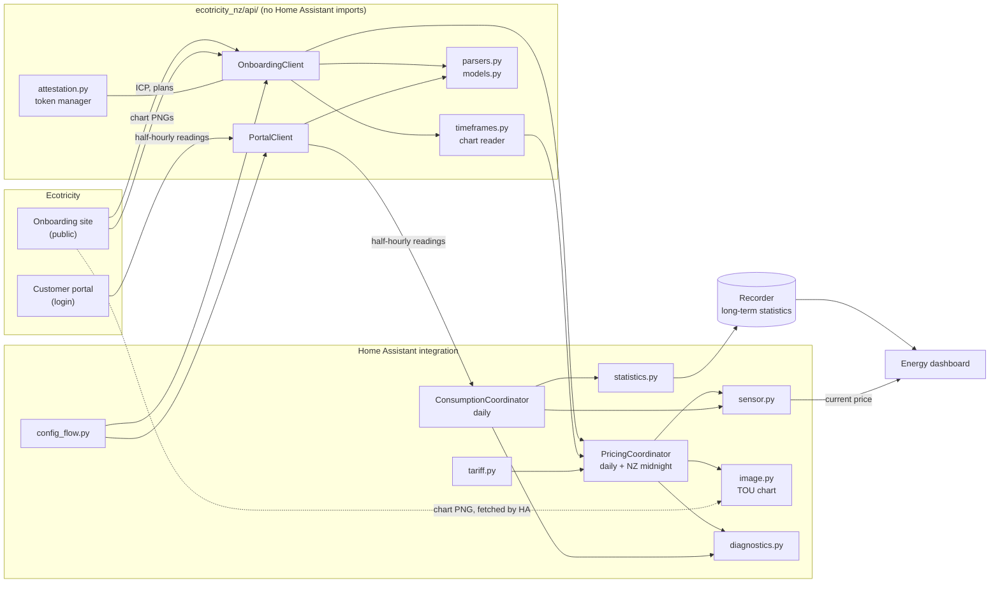
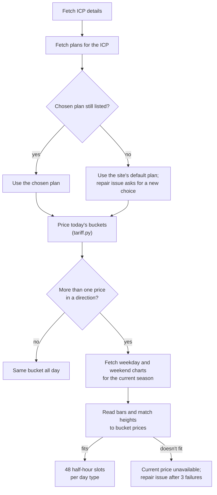
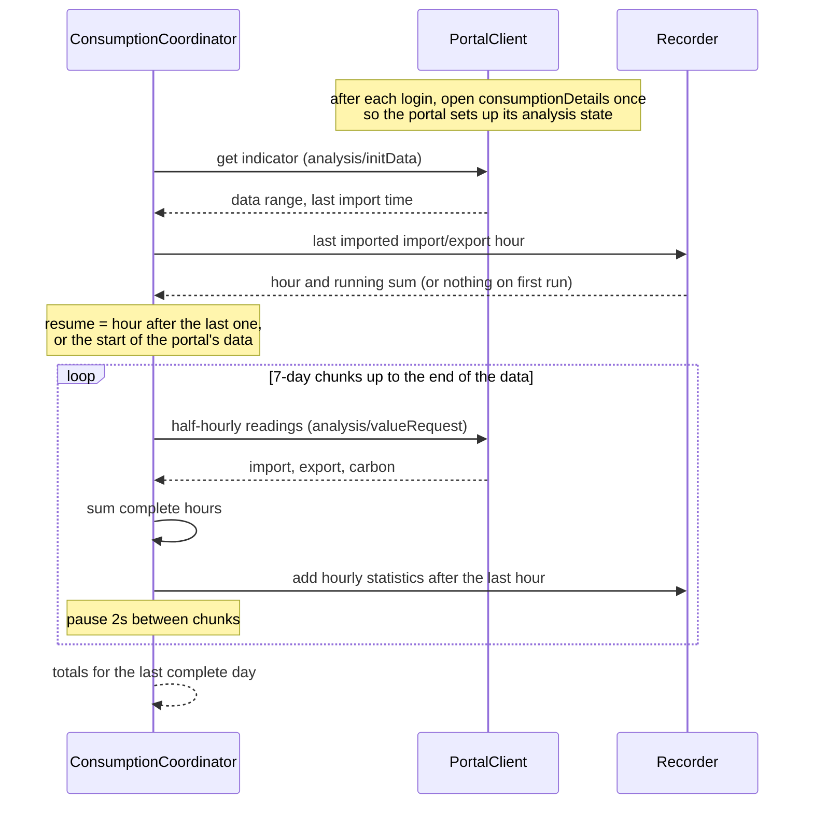
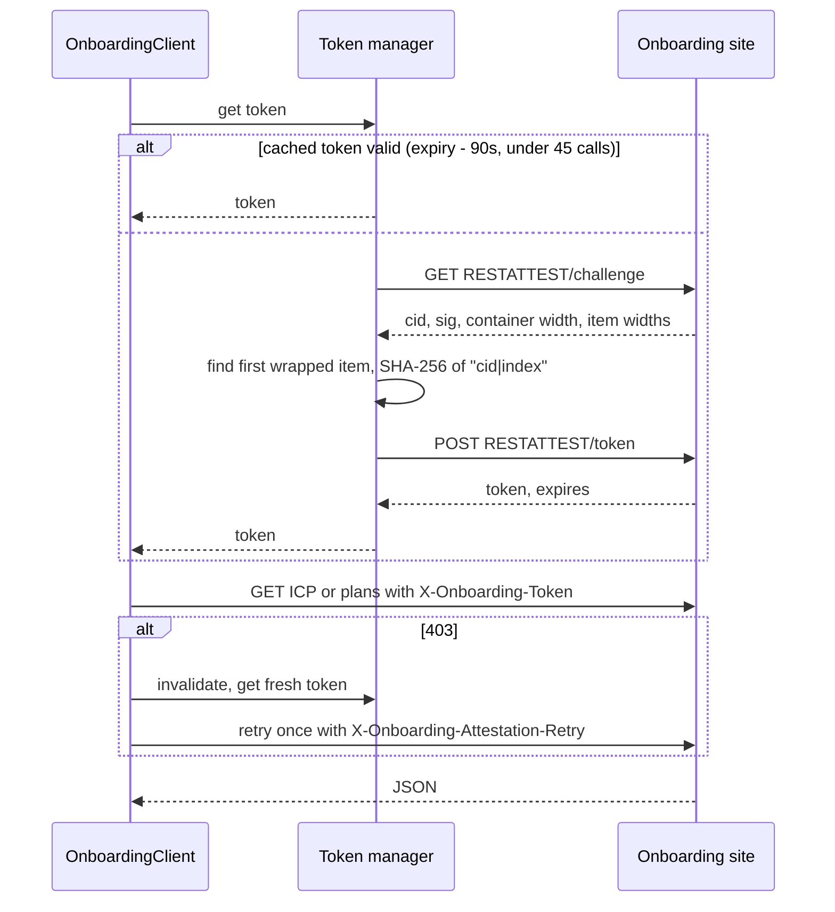

# Architecture

This explains how the integration gets from two Ecotricity websites to sensors and Energy dashboard statistics. For the details of each endpoint, see [api.md](api.md).

## Components

The `custom_components/ecotricity_nz/api/` package is a small client library. It knows nothing about Home Assistant, which keeps it testable on its own and lets it move to PyPI later, as the Home Assistant guidelines prefer.

Everything above it follows the standard integration pattern: a config entry, two `DataUpdateCoordinator`s held in `entry.runtime_data`, and a sensor platform reading from them.

## Setting up an entry

The config flow asks for the ICP number and, optionally, a portal login.

It checks the ICP straight away by fetching its details and plans, and checks the login by signing in. Then it asks which plan the ICP is on, listing the plans by their website names. Neither Ecotricity site reliably says which plan a customer is on, so this is always the user's choice, and it can be changed later in the options.

When the entry loads:

1. The pricing coordinator does its first refresh. If it fails, setup is retried later (`ConfigEntryNotReady`).
2. The sensors are created.
3. If there's a portal login, the consumption coordinator starts its first refresh as a background task. A first run can backfill years of history, so it doesn't hold up setup.

## Pricing

Seasons last a few months and start on the 1st, and Ecotricity can publish new ones or change dates and rates at any time. So the pricing coordinator assumes nothing stays put. It fetches the ICP details, plans, seasons and rates again every 24 hours and again just after each NZ midnight, which means a season starting on the 1st applies from 12:00am that day and any other change shows up within a day. Charts are cached for under a day, so they're downloaded again at least daily too.

Nothing here is specific to one network. Network codes, price categories, plan codes, charge buckets, seasons and time-of-use windows all come from the services for the ICP being set up; the fixtures in the tests use a made-up network.

The per-period price sensors follow the plan. Whenever a refresh turns up a bucket that has no sensor yet (because a new season added a shoulder rate, or a different plan was chosen in the options), the sensor platform adds one.

`tariff.py` turns the plan's retail, network and levy rates into one price per bucket for the day, following the same rules as the onboarding site (listed in [api.md](api.md#how-the-site-combines-rates)). The chart supplies which bucket applies in each half-hour, and the bar heights double as a check: if they don't line up with the prices `tariff.py` worked out, the chart is rejected rather than trusted. Alongside each bucket's total it keeps the parts it was built from (supplier charge, network charge and levies), each tagged with the period of its own rate, so the price sensors can show a breakdown that matches the plan.

The current price, current period and next period change sensors (each for import and export) re-evaluate at every half-hour boundary using their own timers, so they change when the window does rather than at the next poll. The next period change looks no further than the next season change, because a new season can bring new windows.

The time-of-use chart image entity points Home Assistant at Ecotricity's chart for today's day type and season; Home Assistant downloads and caches it.

## Consumption

Portal data arrives a day or two late, so recording it as sensor state would put every reading at the wrong time. Instead the readings become external statistics (`ecotricity_nz:<icp>_energy_import`, `_energy_export` and `_carbon_savings`), which carry their own timestamps and plug straight into the Energy dashboard.

The last imported hour of each statistic is its checkpoint, and each sync continues from the earliest of them, so a statistic added later catches up on the full history. Only the series the portal says it holds are tracked, so an ICP with no export never forces a full re-read. If the portal lists a series but returns no readings for it, the coordinator remembers how far it has read that series, so it's read in full once per Home Assistant start rather than on every sync. Each chunk is written as soon as it's fetched, so an interrupted backfill carries on from where it stopped on the next run. Hours missing a half-hour are held back, so a partly imported day is filled in later instead of being recorded short.

The coordinator always fetches the last complete day, even when it's already imported, to fill the "last day" sensors.

## Signing in to the onboarding site

## Errors and recovery

| What goes wrong | What happens |
| --- | --- |
| Onboarding site unreachable | `UpdateFailed`; sensors go unavailable until the next successful refresh. At setup, the entry retries. |
| Attestation rejected | As above, and after three failures in a row a repair issue says the site has probably changed. |
| Chart unreadable or prices don't fit | Current price and period sensors go unavailable; everything else keeps working. Repair issue after three failures. |
| Portal login rejected | `ConfigEntryAuthFailed` starts the reauthentication flow. |
| Portal unreachable | The consumption import retries at the next refresh; pricing doesn't use the portal. |
| Chosen plan no longer listed | The site's default plan is used, and a repair issue asks for a new choice in the options. |

## Data and privacy

The config entry stores the ICP, and the portal account number and password if given. Nothing else is persisted apart from the statistics.

Diagnostics redact the ICP, account number, password, address, meter serial numbers and portal indicator ID.

Prices are kept in cents excluding GST throughout, and converted to NZD only when a sensor reports its state. GST (15%, unless the option is off) is added to import prices and daily charges. Export credits are shown as published: residential customers who aren't GST-registered are paid the rate without GST.
