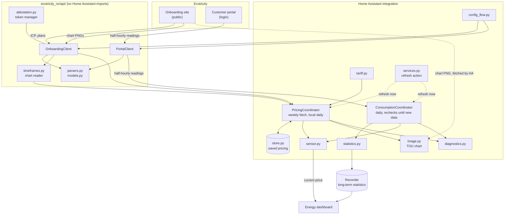
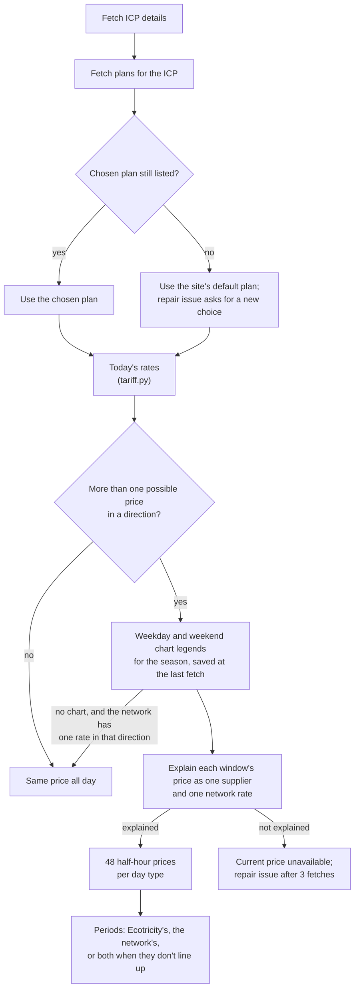
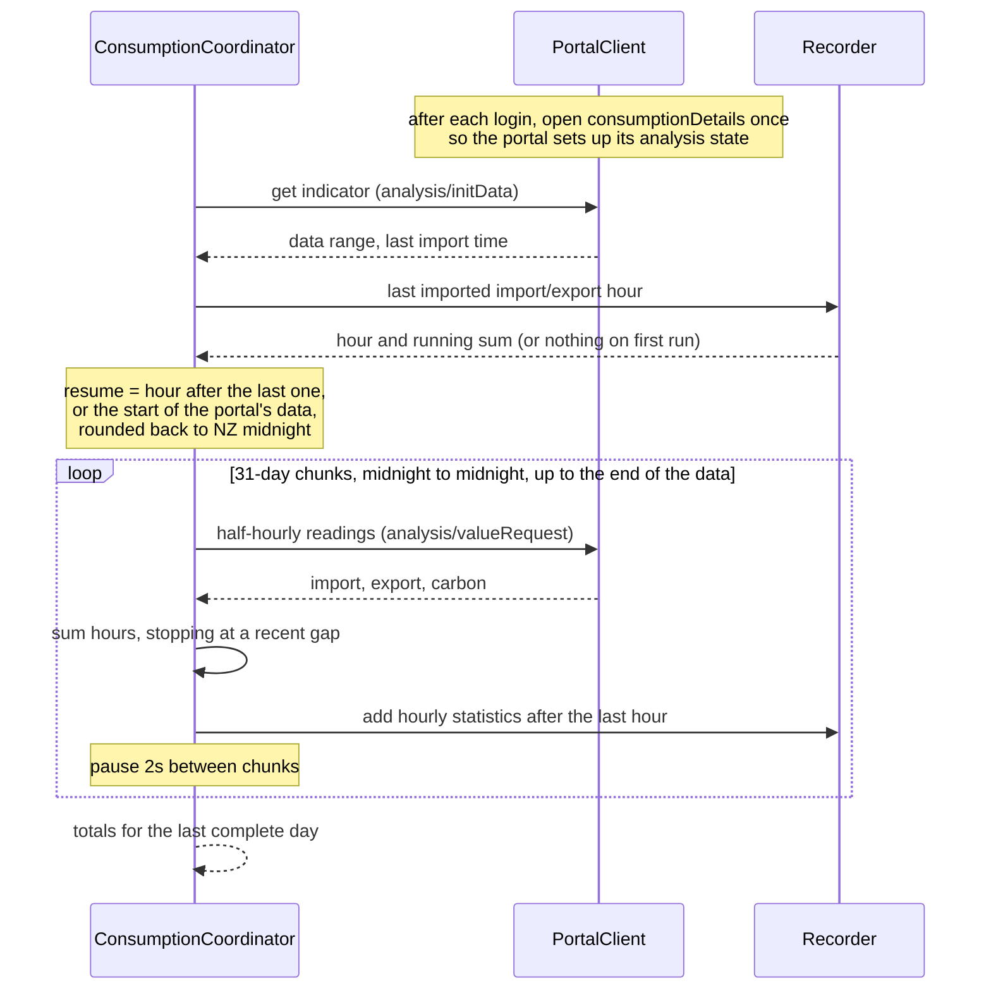
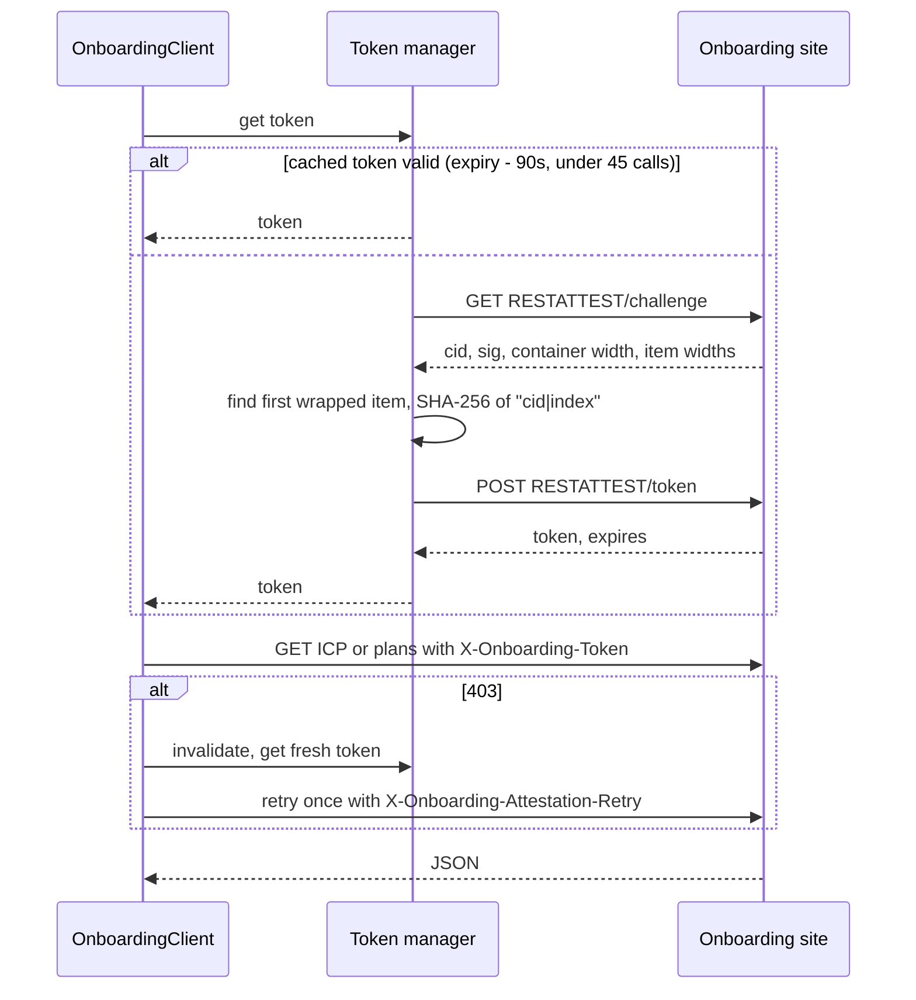

# Architecture

This page explains how the integration sensors and statistics are generated from the Ecotricity APIs and websites. For the details of each API endpoints, see [api.md](api.md).

## Components

The `custom_components/ecotricity_nz/api/` package is a small client library. It knows nothing about Home Assistant, which keeps it testable on its own and lets it move to PyPI later, as the Home Assistant guidelines prefer.

Everything above it follows the standard integration pattern: a config entry, two `DataUpdateCoordinator`s held in `entry.runtime_data`, and a sensor platform reading from them. The `ecotricity_nz.refresh` action, registered in `async_setup` so it exists even when no entry is loaded, makes both coordinators of an entry fetch straight away, whatever their schedule, and raises `HomeAssistantError` if either fetch fails.

## Setting up an entry

The config flow asks for the ICP number and, optionally, a portal login.

It checks the ICP straight away by fetching its details and plans, and checks the login by signing in. Then it asks which plan the ICP is on, listing the plans by their website names. Neither Ecotricity site reliably says which plan a customer is on, so this is always the user's choice, and it can be changed later in the options.

When the entry loads:

1. The pricing coordinator does its first refresh. It loads the saved pricing (see below) and only fetches if something is due, so a restart usually makes no requests and works without an internet connection. If there's no saved pricing and the fetch fails, setup is retried later (`ConfigEntryNotReady`).
2. The sensors are created.
3. If there's a portal login, the consumption coordinator starts its first refresh as a background task. A first run can backfill years of history, so it doesn't hold up setup.

## Pricing

The pricing coordinator keeps fetching separate from working out prices. A fetch downloads the ICP details, plans (with their seasons and rates), plan names, and the chart readings for every published season that hasn't ended. `store.py` saves all of it to `.storage/ecotricity_nz.<entry_id>.pricing`. Each day's prices and windows are worked out from that saved copy with no requests: rates and seasons carry their own dates, and `DaySlots` covers weekdays and weekends. So once a season's pricing has been fetched, everything keeps working through restarts and without an internet connection, into the next season too if Ecotricity had published it.

Just after each NZ midnight, the coordinator works out the new day from the saved pricing and updates the entities. That isn't a coordinator refresh, and it never fetches. Separately, it checks once a day (`PRICING_CHECK_INTERVAL`), counted from when the entry loaded, so installs don't all fetch at midnight on the 1st. A check only fetches when `_fetch_reason` gives a reason:

- Nothing is saved yet, or the refresh action asked for it.
- A different plan was chosen in the options, since only the chosen plan's charts are downloaded. A new plan's charts are all downloaded at once, up to two per season (16 requests at most so far), paced like any other fetch.
- A week has passed since the last fetch, to pick up rate changes and newly published seasons.
- Once a day at most: on the 1st of the month (seasons start on the 1st), on the last day of a season, while no published season covers today or tomorrow, while today's time-of-use windows can't be worked out, and, up to three times after the fetch that found it (`PRICING_MISSING_CHART_RETRIES`), while a side's one network rate is taken to apply all day, today or in a later season, because its charts are missing or don't match its rates (`PricingData.missing_charts`). The count is saved in the snapshot (`PricingSnapshot.missing_chart_fetches`), so a restart doesn't reset it. It starts again once the charts match, and when a fetch finds a gap the last one didn't (`PricingSnapshot.missing_charts`), such as a later season's missing chart that now prices today.

A reason stays true until a fetch succeeds. After a failure, the check interval backs off: 1 hour, then 2, 4 and 8 hours, staying at 8 hours (`PRICING_RETRY_INTERVAL` to `PRICING_RETRY_MAX_INTERVAL`). A short outage is recovered from at the first retry, an hour later, but a long one, or a broken attestation check, costs only a few requests a day. Once a fetch works, or a check finds nothing due, it goes back to daily. While the saved copy is in use, a failed fetch is logged once and doesn't make anything unavailable. The **Last pricing update** sensor shows when pricing was last fetched.

Nothing here is specific to one network. Network codes, price categories, plan codes, charge buckets, seasons and time-of-use windows all come from the services for the ICP being set up. Test fixtures keep real network codes and price categories, which are public, but always use synthetic ICPs and exclude customer-specific details.

`api/timeframes.py` reads each chart's legend: every window and its exact price (see [api.md](api.md#timeframe-charts-time-of-use-hours)). `tariff.py` then explains each price as one of Ecotricity's rates plus one of the network's, plus anytime rates and levies (`explain`), following the rules in [api.md](api.md#how-prices-are-made-up). A price no combination explains rejects the chart rather than being guessed. Each half-hour (`Slot`) keeps its exact price, the two rates' buckets, and the parts it was built from (supplier charge, network charge and levies), so the price sensors can show a breakdown that matches the plan.

Each side (import and export) then gets its periods (`plan_alignment`, across today's season and every later one with readable charts):

- If the price only depends on Ecotricity's period, that's the period. Where Ecotricity has one rate all day and the price depends on the network's period (the battery plans' import), the network's.
- Otherwise the side is split. The period sensor shows the overall period, the one whose own price is nearest the half-hour's price (`price_side`), and a supplier and a network period sensor show each one's own periods.

The plan's periods are worked out over every season, not only today's, so sensors don't come and go with the seasons. Whenever a refresh turns up a period that has no price sensor yet (because a new season added a shoulder rate, or a different plan was chosen in the options), or a side becomes split, the sensor platform adds the sensors. When the plan no longer has a period, or a side lines up again, they're removed from the entity registry, so only the plan's own prices and periods are listed. Until every season's charts can be read, nothing is removed, and the price and split period sensors already in the registry (from before a restart, say) are still provided. The period sensors' options follow the same periods.

The current price, current period and next period change sensors (each for import and export) re-evaluate at every half-hour boundary using their own timers, so they change when the window does rather than at the next poll. The next period change is the next change of period or price, so it also catches a price change within one period on a split side, and looks no further than the next season change, because a new season can bring new windows.

The time-of-use chart image entity points Home Assistant at Ecotricity's chart for today's day type and season; Home Assistant downloads and caches it. When no published season covers today, the chart's dates are unknown, so the entity has no image URL rather than a broken one.

## Consumption

Portal data arrives a day or two late, so recording it as sensor state would put every reading at the wrong time. Instead the readings become external statistics (`ecotricity_nz:<icp>_energy_imported`, `_energy_exported` and `_carbon_savings`), which carry their own timestamps and plug straight into the Energy dashboard.

The last imported hour of each statistic is its checkpoint, and each sync continues from the earliest of them, so a statistic added later catches up on the full history. Only the series the portal says it holds are tracked, so an ICP with no export never forces a full re-read. If the portal lists a series but returns no readings for it, the coordinator remembers how far it has read that series, so it's read in full once per Home Assistant start rather than on every sync. Requests always start and end at NZ midnight, even when resuming partway through a day, and hours already imported are skipped. Midnight never falls inside a daylight saving change, so every response starts with an hour whose occurrence is known, and no hour is split between two chunks. Each chunk is written as soon as it's fetched, so an interrupted backfill carries on from where it stopped on the next run. Because the checkpoint never moves backwards, the import stops at the first hour that's missing or short of a half-hour, and later hours wait until the portal fills it in. That keeps the running sum complete. A gap more than seven days older than the portal's latest data is treated as settled and imported as it stands, so a reading the portal never supplies can't hold up everything after it.

The portal takes in new meter data once a day, at a time that isn't known yet. The coordinator imports once a day, and when an import adds no new hours it switches to checking every 3 hours (`CONSUMPTION_RECHECK_INTERVAL`). A recheck only calls `analysis/initData`, and returns the previous summary while the portal's data range is unchanged. As soon as the range moves, a full import runs and the 24-hour interval resumes from then, so the daily import settles just after the portal's own. While rechecking, a full import still runs once a day, in case the portal has filled in an earlier gap.

The coordinator always fetches the last complete day, even when it's already imported, to fill the "latest day" sensors.

## Signing in to the onboarding site

## Errors and recovery

| What goes wrong                      | What happens                                                                                                                                                                                                                                                                                                                                             |
| ------------------------------------ | -------------------------------------------------------------------------------------------------------------------------------------------------------------------------------------------------------------------------------------------------------------------------------------------------------------------------------------------------------- |
| Onboarding site unreachable          | The saved pricing carries on. The fetch is tried again after 1 hour, then 2, 4 and 8 hours, staying at 8 hours, and the daily check resumes once a fetch works or nothing is due. With nothing saved yet, `UpdateFailed` with the same `retry_after`, and at setup the entry retries.                                                                    |
| Attestation rejected                 | As above, and after three failures in a row a repair issue says the site has probably changed. Only a 403, or a challenge or token in JSON the integration can't make sense of, counts. Any other error status from the attestation endpoints, or a reply that isn't JSON at all (such as a maintenance page), is treated as the site being unreachable. |
| Chart unreadable or prices don't fit | Current price and period sensors go unavailable; everything else keeps working. Each period's price sensor is priced from the rates where they settle it (`rate_periods`), and no price sensor is removed until the charts can be read. Import and export are explained separately, so a mismatch on one side leaves the other working. A later season whose charts can't be read, or whose prices the rates don't explain, is left out and downloaded again at each fetch until they can, and no sensor is removed in the meantime (`PlanPeriods.complete`). A missing chart, or one whose prices don't match, on a side whose network has one rate isn't an error unless the chart shows the price varying with some of the plan's prices: that rate is taken to apply all day, today and in later seasons (which then still count towards `PlanPeriods.complete`), and the chart is fetched daily up to three more times, then at the usual times. Repair issue after three fetches in a row with the problem.                                         |
| Portal login rejected                | `ConfigEntryAuthFailed` starts the reauthentication flow.                                                                                                                                                                                                                                                                                                |
| Portal unreachable                   | Includes the portal still refusing the session straight after a successful login. The consumption import (including the first backfill) retries after 30 minutes; pricing doesn't use the portal.                                                                                                                                                        |
| Chosen plan no longer listed         | The site's default plan is used, and a repair issue asks for a new choice in the options.                                                                                                                                                                                                                                                                |

## Data and privacy

The config entry stores the ICP, and the portal account number and password if given. The pricing coordinator saves what it fetches from the onboarding site in `.storage/ecotricity_nz.<entry_id>.pricing`, which is deleted with the entry. That includes the ICP number and meter serial numbers, which sensors show. The address and region aren't used by any entity, so they're saved blank. Apart from that, only the statistics are persisted.

Diagnostics redact the ICP, account number, password, address, meter serial numbers and portal indicator ID.

Prices are kept in cents excluding GST throughout, and converted to NZD only when a sensor reports its state. GST (15%, unless the option is off) is added to import prices and daily charges. Export prices are shown as published: residential customers who aren't GST-registered are paid the rate without GST. Every price keeps its sign, so an export credit is negative and a cost positive, in sensor states and their breakdowns.
